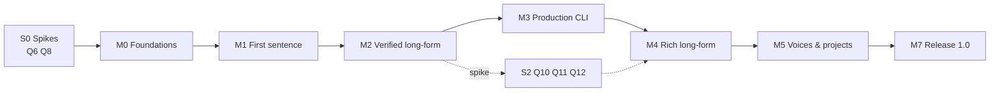

# recite implementation plan

2026-10-11. This plan turns [feature-ledger.md](feature-ledger.md) into an ordered build. The
design it implements is [design.md](design.md). Ledger IDs (`NET-03`) and design sections (`§8.4`)
are the reference: when this plan and the ledger disagree on *what* to build, the ledger wins.
This plan owns *order*, *grouping*, *gates* and *how each step is proven*.

---

## 1. Ground rules

### 1.1 Unit of work

The unit is a **work package (WP)**: one coherent change, one commit (or a short series),
finishing green. A WP lists:

- the ledger features it completes;
- the tests that are written **first**, from the ledger's acceptance criteria;
- the files it creates or changes;
- its exit check, which is always `make check` green, plus any live check named.

A WP is done only when every acceptance bullet of every ledger feature it claims is proven by a
test that carries a `// accept: FEATURE#n` reference (ledger "How to read"), checked by
`tools/acceptcheck`. Live and qualification bullets are proven by the live suites (§1.4). A
feature delivered across several WPs is marked done in the ledger only when its last WP lands.

A bullet that cannot be proven at its feature's WP, because it needs something built later, is
listed in §1.7 with the WP that completes it. Nothing else may be deferred.

### 1.2 Test-first and fakes-first

- Every network-facing component is built against its fake first (FND-04, FND-05, FND-06) and
  touches the real service only in the live suite.
- Golden files live next to their tests in `testdata/`, updated only with `-update`, and
  reviewed as part of the diff.
- Fuzz targets get a seed corpus in `testdata/fuzz/`; `make check` replays the seeds, and
  `make fuzz` runs each target for 60 s at milestone exits (§1.3).

### 1.3 The quality gate

`make check` is the only merge gate, locally and in CI (FND-03): `gofmt -l`, `go vet`,
`golangci-lint` (staticcheck runs inside it), `go test -race ./...` (which replays every fuzz seed
corpus), `govulncheck`, the dependency allowlist test, `tools/acceptcheck`, and the
secret-artifact test (AUTH-05) once it exists. A WP that leaves any of these red is not done.
There is no skip list.

Two more targets run at every milestone exit and in a scheduled CI job, not per commit:
`make fuzz` (60 s per fuzz target) and `make bench` (timing and memory targets, on a stated
machine). Timing and memory are never hard assertions under `-race` (R#15).

The dependency allowlist is: `coder/websocket`, `BurntSushi/toml`, `yuin/goldmark`,
`golang.org/x/text`, sayso and, only through sayso, `golang.org/x/sys`, and test-only `go.uber.org/goleak` and `santhosh-tekuri/jsonschema/v6`
(v6.0.3, JSON Schema 2020-12, for the schema tests in WP-2.9, WP-3.3 and WP-3.8; R#12).

### 1.4 The live suites

All live work uses the real Codex sign-in and spends real (unbilled) usage. It never runs in CI.
There are three targets, each with an enforced budget, checked twice (R#4):

- **Before rendering:** the harness totals the estimated audio × 2.2 (the duration guard's upper
  bound) × the maximum attempts, and refuses to start over budget.
- **While rendering:** it counts the **actual** audio received, including rejected takes. When
  the budget is reached it stops dispatching **and cancels every in-flight render** (closing its
  session); audio that arrived before the cancel is counted, so overshoot is bounded by `jobs ×`
  the audio of one in-flight chunk. The run reports itself incomplete.
- Gate commands in this plan state their `--max-attempts`, so the preflight product is explicit.

| Target | Purpose | Budget per invocation |
|---|---|---|
| `make live` | Smoke tests: wiring against the real service (`//go:build live`) | ≤ 10 min of audio |
| `make qualify` | Milestone gates and qualification criteria with sample sizes (`//go:build qualify`) | ≤ 30 min; larger gates are sharded, each shard resumable, with results aggregated from `$TMPDIR/recite-live/` |
| `make calibrate` | VER-07 and VER-11 calibration | ≤ 30 min per shard; sharded across days if plan limits appear |

Rules:

- Run at the end of each milestone, and by any WP whose exit check names it.
- A live failure caused by the service (5xx, route denied) is reported with its error class
  and request IDs. It never turns into a skipped test.
- Artifacts go to `$TMPDIR/recite-live/<timestamp>/`, never into the repository.
- Qualification evidence identifies the complete ordered corpus, effective settings and attempt
  limits, and implementation revision. Aggregation rejects mismatched identities, duplicate or
  missing chunk IDs, and incomplete shard sets. Changing a probe corpus item invalidates prior
  results. *(D19)*

### 1.5 Commits

Small and atomic, one WP or one sub-step per commit. Messages are written to a file and
committed with `git commit -F`. Before each commit: the staged diff is checked for secrets
(the AUTH-05 grep test, plus `jev docket secret-scan`). No AI attribution lines.
Before the first push, confirm secret-scan coverage of every reachable commit being published,
including content removed from HEAD; record the probabilities and directly inspect inconclusive
inputs. Uncommitted working-tree changes are outside that push. *(D19)*

### 1.6 Evidence

Every measured fact in design §3 is reproducible from a committed probe. Before M1 starts, these
must run green from a clean checkout: `probe_auth.py` (E17, E19), `probe_effort.py` (E21),
`probe_v2.py` (E23), `probe_hijack.py` (E22, E24), `probe_textnorm.py` (E25), and
`probe_matrix.py` and `probe_design.py` (E1–E16). Done 2026-10-11 for `probe_auth`,
`probe_effort` and `probe_v2` (R#8).

### 1.7 Bullets completed after their feature's WP

| Bullet | Needs | Completed in |
|---|---|---|
| NET-05: WebSocket close-code and `error`-event rows | NET-03, NET-04 (WP-1.4) | WP-1.4 (WP-1.2 builds the class table and HTTP rows) |
| CLI-03: codes 5, 6, 130 | verification, retries, cancellation | WP-2.6 (5), WP-2.8 (6, 130) |
| VER-08: the manifest form of the attempt record | OUT-02 | WP-3.3 |
| RUN-03: "verified takes present in the cache" | RUN-04 | WP-3.2 |
| TXT-02: `G-CONTROL` findings | TXT-09 | WP-2.2 |
| TXT-14: extra attempt only on flagged chunks | VER-08 | WP-2.6 |
| TXT-11: live verification of the normalised corpus | assembly and verification; revised corpus and qualification evidence identity (D19) | WP-2.9; fresh live qualification in WP-3.5 |
| VER-02: fallback recorded in the manifest | OUT-02 | WP-3.3 |
| AUTH-05: manifest, rejected-take and usage-ledger artifacts in the canary search | OUT-02, OUT-06, OBS-03 | WP-3.3 |

### 1.8 Stop conditions

Stop and escalate to the owner, instead of working around it, when:

- a live probe shows **route A is closed** (`route-denied` on mint for every model);
- the token's audience or the Codex `getAuthStatus` contract changes incompatibly;
- an acceptance criterion turns out to be unachievable as written. The ledger is amended with
  evidence first, then the code; a criterion is never quietly weakened.

---

## 2. Phase map

M6 was dropped (the project is TTS only); the gap in numbering is kept so ledger IDs stay stable.

| Phase | WPs | Features | Gate to leave the phase |
|---|---|---|---|
| S0 | 2 | — (answers Q6, Q8) | Written spike reports; AUTH-04 and NET-01 move from `open` to `designed` or the ledger is amended |
| M0 | 4 | 7 | `make check` green in CI on macOS and Linux; fakes usable from tests |
| M1 | 7 | 25 | `recite say "Hello" -o h.wav` works live; the live test transcribes it and matches |
| M2 | 10 | 26 | Mini calibration passes on held-out samples (superseded by D23: reported, not gated); a 600-word English text (about 4 min of audio) renders, verifies and assembles live with `--jobs 3 --max-attempts 2`; interrupt and re-run behaves as specified |
| M3 | 10 | 26 | Re-run of an unchanged text makes zero renders; `doctor --deep` passes; Chinese text verifies live; full calibration passes (superseded by D23: reported, not gated) |
| M4 | 6 | 12 | A Markdown chapter becomes an `.m4b` with chapters, subtitles and loudness targets met |
| M5 | 3 | 5 | A 3-speaker script and a 2-output project render live |
| M7 | 3 | 5 | Release 1.0: signed, notarised binary installed from the Homebrew tap; release checklist green |

---

## 3. S0 — Spikes before code (answer the open questions that sit in M1)

Spikes are throwaway Python probes in `dev-docs/`, like the existing ones. Each ends with a
short report in `dev-docs/spikes/`, and a ledger update.

### WP-S0.1 · Token refresh through Codex (Q6 → AUTH-04)

**Status:** DONE — 2026-10-11
**Changed:** dev-docs/spike_refresh.py, dev-docs/spikes/s0.1-refresh.md, dev-docs/feature-ledger.md (AUTH-04 → designed)
**Verified:** uv run dev-docs/spike_refresh.py (RESULT SAFE, exit 0); codex exec in the spike home after refresh (answered "ok", exit 0)

- **Question:** does `getAuthStatus {includeToken: true, refreshToken: true}` refresh safely,
  including while a Codex TUI session is running on the same `CODEX_HOME`?
- **Method:** in an **isolated** `CODEX_HOME` with its own `codex login` (never the real one):
  call it with refresh on, confirm a new access token, confirm `codex exec "echo ok"` still works
  in that home, and repeat with a concurrent `codex` session open.
- **Outcome rule:** if safe, AUTH-04 becomes `designed`. If not, AUTH-04 is amended to "no
  refresh; exit 3 with re-login guidance", and design D2 is updated.
- **Clock-time note:** needs the owner to run one interactive `codex login` for the isolated
  home (`! CODEX_HOME=/tmp/recite-spike-home codex login`).

### WP-S0.2 · HTTPS proxy for REST and WebSocket (Q8 → NET-01)

**Status:** DONE — 2026-10-11
**Changed:** dev-docs/spikes/proxy/main.go, dev-docs/spikes/proxy/go.mod, dev-docs/spikes/proxy/go.sum, dev-docs/spikes/s0.2-proxy.md, dev-docs/feature-ledger.md (NET-01 → designed)
**Verified:** go vet . && go run . in dev-docs/spikes/proxy (mint 200, wss session.created, STT 200; RESULT WORKS, exit 0)

- **Question:** do mint, `wss://` and the multipart STT upload work through a CONNECT proxy
  with `http.ProxyFromEnvironment` and `coder/websocket`?
- **Method:** a 60-line Go spike in `dev-docs/spikes/proxy/` (its own `go.mod`), through a local
  proxy (`mitmproxy --mode regular` without TLS interception, or a minimal Go CONNECT proxy).
- **Outcome rule:** if it works, NET-01 becomes `designed`. If `coder/websocket` cannot use the
  proxy, record the workaround (custom `HTTPClient` dial), or downgrade proxy support to
  documented-unsupported, with owner sign-off.

---

## 4. M0 — Foundations

### WP-0.1 · Skeleton, module, dependency allowlist

**Status:** DONE — 2026-10-11
**Changed:** go.mod, deps_test.go, Makefile, .golangci.yml, README.md, cmd/recite/{doc,main}.go, internal/*/doc.go (20 packages)
**Verified:** gofmt -l . (empty); go vet ./...; go build ./...; go test -race -count=1 . (ok github.com/xiaolai/recite)

- **Features:** FND-01.
- **Tests first:** `deps_test.go` reads `go.mod` and fails on any module outside the allowlist of
  §1.3.
- **Creates:** `go.mod` (`module github.com/xiaolai/recite`, `go 1.27`, `toolchain` pinned), the
  package directories of design §4 with `doc.go` each, `cmd/recite/main.go`, `Makefile`,
  `.golangci.yml`, `README.md` (stub).
- **Exit:** `go build ./...`, `go test ./...` green.

### WP-0.2 · CI gate

**Status:** DONE — 2026-10-11
**Changed:** Makefile, gate_test.go, tools/acceptcheck/{main.go,main_test.go,deferred.txt,testdata/}, .github/workflows/check.yml
**Verified:** make check (exit 0, 54 s warm; acceptcheck: 1 done features, 3 bullets referenced, OK). First pushed-branch CI (2026-10-11, commit 17b8d2a, run 38139750104): `check (ubuntu-latest)` success, `check (macos-latest)` success.

- **Features:** FND-03.
- **Creates:** `tools/acceptcheck` (parses the ledger's acceptance bullets and the `// accept:`
  references; its own tests use a fixture ledger); `Makefile` targets `check`, `fuzz`, `bench`,
  `live`, `qualify`, `calibrate`; `.github/workflows/check.yml` running
  `make check` on `macos-latest` and `ubuntu-latest`; tool versions pinned via `go run
  tool@version` (no global installs).
- **Exit:** the workflow is green on a pushed branch. *(Clock wait: first CI run.)* If the owner
  has not created a remote, the exit check is `make check` locally, and CI is verified at the
  first push.

### WP-0.3 · Router, help, version

**Status:** DONE — 2026-10-11
**Changed:** internal/cli/{cli,globals,commands,help,suggest,version}.go, internal/cli/{cli_test,version_test}.go, internal/cli/testdata/*.golden, internal/buildinfo/buildinfo.go, cmd/recite/main.go, Makefile
**Verified:** make check (exit 0; acceptcheck: 2 done features, 6 bullets referenced, OK); built binary: `recite sya` → exit 2 with suggestion and how to speak the word, `recite version` prints injected values

- **Features:** CLI-01, FND-02.
- **Tests first:** golden help output; `recite "Hello"` and `recite say "Hello"` resolve to the
  same command; `recite say check` keeps `check` as text; `recite sya` suggests `say`;
  interspersed flags; ldflags injection prints values, un-injected prints `dev`/`unknown`.
- **Creates:** `internal/cli` (router, global flags), `cmd/recite`.

### WP-0.4 · Fakes and fixtures

**Status:** DONE — 2026-10-11
**Changed:** dev-docs/record_fixtures.py, testdata/realtime/*.jsonl (6 scenarios), internal/realtime/fake/{server,synth}.go and tests, internal/codexapp/fake/{fake.go,fake_test.go,cmd/fakecodex/main.go}, internal/stt/fake/{fake,fake_test}.go, internal/{auth/token,realtime/types,stt/types}.go, go.mod, go.sum
**Verified:** uv run dev-docs/record_fixtures.py (6 scenarios recorded live, scrubbing lint passed); make check (exit 0)

- **Features:** FND-04, FND-05, FND-06.
- **Step 1, fixture recorder:** `dev-docs/record_fixtures.py` (Python, like the probes) renders
  the fixture scenarios against the live service and writes `testdata/realtime/*.jsonl`. It
  replaces audio payloads with deterministic generated PCM (a sine sweep of the same length),
  and drops `ek_…`, `eyJ…`, request IDs, session IDs and account identifiers. Scenarios: speak
  with OOB metadata, three OOB chunks on one session, a request-like answer (E22), an `error`
  event, an `incomplete` response, realtime transcription. No translation fixtures (R#33).
- **Step 2, Go fakes:** `internal/realtime/fake` (an `httptest` server for mint plus WebSocket,
  scenario replay, fault injection), `internal/codexapp/fake` (the test binary built in
  `TestMain`, with modes), `internal/realtime/fake` and `internal/stt/fake` scripted interfaces.
- **Tests first:** a fixture lint test (no `ek_`/`eyJ`; every event has `type`); every fault
  hook reachable; the fake app-server answers every mode.
- **Live:** run the recorder once. *(Live usage: about 1 minute of audio.)*

**M0 exit:** `make check` green on macOS and Linux; the fakes are exercised by their own tests.

---

## 5. M1 — First sentence

Scope limit for M1: `say` accepts input up to **one chunk** (25 s estimated duration). Longer
input → exit 2 "multi-chunk input arrives in M2". This keeps M1 honest without a half-built
segmenter. M1 output is not verified in-tool (verification arrives in M2); the live test
verifies it externally.

### WP-1.1 · Logging, redaction, secret types

**Status:** DONE — 2026-10-11
**Changed:** internal/logx/{scrub,handler,setup}.go, internal/fsx/fsx.go, internal/harden/{harden,harden_linux,harden_other}.go, internal/auth/token.go, internal/cli/cli.go, cmd/recite/main.go, tests in each package, tools/acceptcheck/deferred.txt (AUTH-05#2 → WP-1.3, which already tests it)
**Verified:** make check (exit 0); GOOS=linux go test -c ./internal/harden (compiles; the Linux dumpable test runs on Linux CI)

- **Features:** OBS-01, AUTH-05 (the canary search grows as artifacts appear, §1.7).
- **Tests first:** formatting and `json.Marshal` of `Token` and `ClientSecret` contain no secret;
  the handler scrubs the message, nested groups and wrapped errors, by pattern and by exact
  registered bytes; private directories and files get `0700`/`0600` through `internal/fsx`, and a
  pre-existing `0777` directory is tightened; `RLIMIT_CORE` is 0 (and on Linux `PR_GET_DUMPABLE` is 0) after start-up; a symlink in a
  private path is refused without touching its destination; a golden log line.
- **Creates:** `internal/logx`, `internal/fsx`, `internal/auth/token.go`.

### WP-1.2 · HTTP client and error classes

**Status:** DONE — 2026-10-11
**Changed:** internal/openai/{client,policy,errors}.go and tests (client, errors, proxy, helpers), internal/exitcode/exitcode.go and test, internal/cli/commands.go
**Verified:** make check (exit 0); go test -race -count=1 ./internal/openai (ok). NET-05's WebSocket rows remain deferred to WP-1.4.

- **Features:** NET-01 (as settled by S0.2), NET-05 (class table and HTTP rows; the WebSocket
  rows complete in WP-1.4, §1.7).
- **Tests first:** the NET-01 origin-policy table (host, scheme, port, userinfo, `Host` override,
  same-host and cross-host 3xx), exercised through the production transport with fakes injected
  below it; TLS minimum; the HTTP rows of the §5.3 classification table; proxy behaviour per
  S0.2.
- **Creates:** `internal/openai`.

### WP-1.3 · Credentials

**Status:** DONE — 2026-10-11
**Changed:** internal/codexapp/{client,methods}.go and tests, internal/auth/{guard,file,codex,source}.go and tests, internal/auth/live_test.go, internal/codexapp/fake (request recording, FAKECODEX_LEAK)
**Verified:** make check (exit 0); RECITE_LIVE=1 go test -tags live -run TestLiveAuth ./internal/auth (PASS, 0.97 s, real ChatGPT sign-in)

- **Features:** AUTH-03, AUTH-02, AUTH-01.
- **Note:** token refresh needs a mint to test its 401 → refresh → retry path, so it is built in
  WP-1.4. The login-state probe and `auth status` depend on refresh, so they are completed in
  WP-1.4 too (A#1).
- **Order:** guard → file source → app-server source.
- **Tests first:** against FND-05 modes: `chatgpt` returns a token; `apikey`
  → exit 3 with the exact message; `logged-out`, `slow` (10 s timeout), `crash`; the child stays
  alive after the call and is reaped on `Close`; argv and environment contain neither the token
  nor `OPENAI_API_KEY`; canary bytes on the child's stderr never surface; in `apikey` mode
  `includeToken: true` is never sent; the file source
  opens `O_RDONLY` with a 64 KiB cap; a canary `OPENAI_API_KEY` in a fixture `auth.json` never
  appears anywhere.
- **Creates:** `internal/codexapp`, `internal/auth`.
- **Live:** `TestLiveAuth`: token returned in under 2 s, with `aud = https://api.openai.com/v1`.

### WP-1.4 · Mint, WebSocket, event codec

**Status:** DONE — 2026-10-11
**Changed:** internal/realtime/{mint,session,events}.go and tests, internal/realtime/testdata (mint goldens, fuzz corpus), internal/auth/{refresh,state,guide}.go and tests, internal/auth/testdata/guide-*.golden, internal/openai/{wsclass.go,errors.go}, internal/cli/{auth,cli,commands}.go, internal/codexapp, the two fakes, docs/schema/events.schema.json, go.mod, go.sum
**Verified:** make check (exit 0); live: TestLiveAuth, TestLiveProbeReady (0.37–0.46 s over 6 runs after making the plan lookup opt-in), TestLiveAuthURL, TestLiveRefreshIsolatedHome (spike home) all PASS; built `recite auth status` → ready, exit 0

- **Features:** NET-02, NET-03, NET-04, AUTH-04 (as settled by S0.1), AUTH-07, AUTH-06, and the
  WebSocket rows of NET-05.
- **Tests first:** golden mint bodies for speech and realtime transcription (all five efforts,
  speeds, `tools: []`); 400/401/403/429/500 classification through the fake; no client pings
  during a 10 s render; context cancel unblocks a read (correctness only; latency is a
  benchmark); a peer that never acknowledges close → `Close` returns within 2.5 s via
  `CloseNow`; `goleak`; decoder fuzz; unknown events tolerated; `response.done` without status →
  `protocol`; WebSocket close codes and `error` events classified; single-flight refresh under 8
  concurrent mint 401s (AUTH-04); every AUTH-07 bullet (all eight modes plus an unknown one,
  token outcomes, source resolution, context binding, guides, the `codex-error` class), with the
  M1 events schema `docs/schema/events.schema.json` v1 holding the `auth_error` event; `auth
  status` exits 0 only when `ready` and prints no secret or account identifier.
- **Creates:** `internal/realtime` (`mint.go`, `session.go`, `events.go`), `internal/auth/refresh.go`,
  `internal/auth/state.go`, `internal/auth/guide.go`, `docs/schema/events.schema.json` (v1).
- **Live:** state `ready` in under 2 s; `guide.AuthURL` resolves and mentions `codex login`.

### WP-1.5 · Speech settings and instructions

**Status:** DONE — 2026-10-11
**Changed:** internal/realtime/{instructions,settings,request}.go and tests, internal/realtime/testdata (mint and response-create goldens), internal/cli/{commands,help}.go, internal/cli/{say_test,cli_test}.go, internal/cli/testdata/help-say.golden, tools/acceptcheck/deferred.txt (SPK-10#3 and SPK-05#3 → WP-1.6, which adds rendering; the live parts of SPK-02#1 and SPK-04#1 also land there)
**Verified:** make check (exit 0); TestInstructionsPinned proves the Go INSTR v2 text is byte-identical to the probe text that measured 87/87

- **Features:** SPK-02, SPK-03, SPK-04, SPK-10, SPK-05.
- **Tests first:** local validation with exit 2 and no network for model, voice, speed and
  effort; the exact INSTR v2 text pinned with its version; golden request: rules in
  `instructions`, only the delimited text in the message; `G-MARKER` escaping is stubbed here as
  a precondition check (any `<<<`/`>>>` in M1 input → exit 2, until TXT-09 lands in M2).
- **Creates:** `internal/realtime/instructions.go`, settings validation in `internal/cli`.

### WP-1.6 · Render one chunk

**Status:** DONE — 2026-10-11
**Changed:** internal/realtime/{synth.go,types.go}, internal/realtime/{synth,live_helpers,live,qualify}_test.go, internal/realtime/testdata/{render-mismatch.jsonl,qualify-instr-v2.txt}
**Verified:** make check (exit 0); live: TestLiveRenderHello, each model, each effort, speed 1.5 < 1.0 all PASS; qualify: TestQualifyInstructionsV2 87/87 first attempt (Wilson 95% 0.958–1.000)

- **Features:** SPK-01.
- **Tests first:** PCM equals the concatenated deltas; `Said` concatenated; usage parsed;
  mismatched `metadata.chunk` → `protocol`; hard timeout = 3 × estimate + 30 s.
- **Live:** `TestLiveRenderHello`: "Hello from recite." renders on `gpt-realtime-2.1`.

### WP-1.7 · `say` v1: input, WAV, output, exit codes

**Status:** DONE — 2026-10-11
**Changed:** internal/text/input.go, internal/audio/wav.go, internal/cli/{say,output,cli,commands,auth,help}.go, internal/exitcode/exitcode.go, README.md, readme_test.go, tests and goldens in those packages, go.mod, go.sum
**Verified:** make check (exit 0); make live (all packages PASS); M1 gate TestLiveSayHello PASS: real `recite say "Hello"` wrote a WAV that gpt-transcribe heard as "Hello"

- **Features:** TXT-01, TXT-02, AUD-01, OUT-01, CLI-03, CLI-02 (M1 slice).
- **Tests first:** one source exactly; invalid UTF-8 or NUL → exit 2 with offset; empty → exit 2;
  NFC and newline rules (golden plus idempotence fuzz); control characters → exit 2 in M1 (the
  guard takes over in M2); WAV round-trip and > 4 GiB refusal; atomic publication survives
  SIGKILL; `link`-based publication never overwrites a target created after pre-flight;
  `--force` replaces a symlink without following it; exit codes 0–4 and 7 (the rest per §1.7);
  the severity order; the README exit-code table matches the constants.
- **Live:** `TestLiveSayHello`: `recite say "Hello" -o $TMP/h.wav` exits 0, and the test
  transcribes the file over HTTP and matches it.

**M1 exit:** live `say "Hello"` works; `make check` green; the AUTH-05 artifact test covers logs
and outputs.

---

## 6. M2 — Verified long-form

Two lanes can run in parallel after WP-2.1: **text** (WP-2.2 → 2.3 → 2.4) and **verification**
(WP-2.5 → 2.6). They meet at WP-2.7.

### WP-2.1 · Script detection, language resolution, canonicaliser

**Status:** DONE — 2026-10-11
**Changed:** internal/text/{lang,lang_test}.go, internal/verify/{canon,canon_test}.go, internal/verify/testdata/fuzz/FuzzCanon/
**Verified:** make check (exit 0); go test -fuzz FuzzCanon -fuzztime 120s (PASS after fixing two fuzz-found bugs). TXT-04#2's language-guard half is tested in WP-2.6, where the guard is built.

- **Features:** TXT-04, VER-03.
- **Tests first:** the TXT-04 table (script, language and hint for English, French, Spanish,
  Chinese, Japanese with and without kana, Korean, Russian, mixed); no hint from the Latin
  default; every VER-03 equivalence pair; canonicaliser idempotence fuzz.
- **Creates:** `internal/text/lang.go`, `internal/verify/canon.go`.

### WP-2.2 · Text guard and request detection

**Status:** DONE — 2026-10-11
**Changed:** internal/guard/{finding,spanmap,detect,request,guard,guard_test}.go, internal/guard/testdata/{messy.golden,fuzz/}, testdata/request-like.tsv, internal/cli/{commands,say}.go, internal/cli/{say_guard_test,cli_test,say_test,say_run_test}.go, internal/cli/testdata/{say-marker-request,help-say}.golden, internal/text/{input,input_test}.go (M1 control-character and marker preconditions removed)
**Verified:** make check (exit 0); go test -fuzz FuzzGuard 90 s (PASS); built binary: `--guard strict` on messy input exits 2 before auth, no file written

- **Features:** TXT-09, TXT-14.
- **Tests first:** golden findings for the messy corpus (the 21 `probe_textnorm.py` items plus
  HTML, LaTeX, homoglyph, bidi, long-hash and marker cases); `strict` → exit 2 with no request
  reaching the fake; marker escaping in the golden request; guard idempotence fuzz; no word is
  ever added; the 100-sentence labelled set reaches recall ≥ 90% for `G-REQUEST`.
- **Creates:** `internal/guard`, `testdata/guard/`, `testdata/request-like.tsv` (labelled set,
  written by hand in this WP).
- **Removes:** the M1 marker precondition (WP-1.5).

### WP-2.3 · Spoken-form engine and English rules

**Status:** DONE — 2026-10-11
**Changed:** internal/spoken/{engine,scan,en,en_date,en_words}.go and tests, internal/spoken/testdata/{en-golden.tsv,qualify-en.txt}, internal/numwords/, internal/verify/canon.go (uses numwords; output unchanged), internal/cli/{commands,say}.go, internal/cli/say_spoken_test.go, internal/guard/detect.go (→ readable by the spoken stage), goldens
**Verified:** make check (exit 0); FuzzSpoken 90 s and 180 s clean; follow-up 04c34bc–058e7a6: make check (exit 0), FuzzSpoken 3×150 s + 300 s clean

- **Features:** TXT-10, TXT-11.
- **Tests first:** the segment-based span-map invariant fuzz, including `42`, `$3.5M`, `[1]` and a
  `{{say}}`-style rewrite; rule disabling; idempotence; the 200-pair
  English golden table (including every §7.5 probe item); the ambiguity cases yield `N-AMBIGUOUS`.
- **Creates:** `internal/spoken` (engine plus `en` tables).
- **Live:** the TXT-11 qualification criterion, run in WP-2.9 once verification and assembly
  exist (§1.7).

### WP-2.4 · Segmentation

**Status:** DONE — 2026-10-11
**Changed:** internal/text/segment.go, internal/text/segment_test.go, internal/text/testdata/fuzz/FuzzSegment/
**Verified:** make check (exit 0); FuzzSegment 130 s (worktree) and 150 s (main) clean; segmentation and spoken form timed linear up to 640 KB

- **Features:** TXT-03.
- **Tests first:** reconstruction fuzz (spoken form and display text); the golden edge cases;
  the 1.3× budget bound.

### WP-2.5 · STT clients, scorer, keyword prompt

**Status:** DONE — 2026-10-11
**Changed:** internal/stt/{chain,http,realtime,types}.go and tests, internal/stt/testdata/transcription-request.golden, internal/realtime/fake/server.go, internal/verify/{canonspans,keywords,score}.go and tests, internal/verify/data/en-10k.txt, internal/verify/testdata/keywords/
**Verified:** make check (exit 0); RECITE_LIVE=1 go test -tags live ./internal/stt (TestLiveHTTPKnownSentence PASS)

- **Features:** VER-01, VER-02, VER-04, VER-10. (VER-02 moved from M3 so the per-route breaker of
  WP-2.8 can be tested against a real fallback, N1.)
- **Tests first:** golden multipart body with `languages[]`; response decoding with a populated
  and an empty `languages` list; `missing_scope` → `route-denied` for this route only; scorer
  exact on known pairs; alignment spans in display coordinates; the keyword prompt < 30% of
  chunk tokens (fuzz); one retry on a dropped connection (E26); the realtime fallback: three
  commits on one session matched by `item_id`, switch logged once. Benchmark (not a test): 2,000
  words scored in < 50 ms.
- **Creates:** `internal/stt`, `internal/verify/score.go`, `internal/verify/keywords.go`, with a
  bundled frequency list (`testdata`-independent, `embed`).
- **Live:** a known sentence returns its exact text, and `languages[0].code` is `en`.

### WP-2.6 · Guards and adjudication

**Status:** DONE — 2026-10-11
**Changed:** internal/verify/{guards,adjudicate}.go and adjudicate_test.go, internal/audio/trim.go and trim_test.go, internal/verify/{score,keywords}.go (alignment and offsets exposed; output unchanged), internal/realtime/fake/synth.go (fake takes carry signal so trimming keeps them), tools/acceptcheck/deferred.txt (TXT-14#2 covered)
**Verified:** make check (exit 0; acceptcheck 110 bullets, 1 deferred); deliberate breaks of the repeated-mismatch and edge checks failed 7 and 2 tests

- **Features:** AUD-02, VER-05, VER-06, VER-08, VER-09, CLI-03 (code 5).
- **Tests first:** trimming on synthetic signals; each guard's scripted failure (said, empty,
  duration, status) re-renders with zero STT calls; the language guard; a recorded
  answer-instead-of-read take is rejected by the said guard; edge-insertion and protected-token
  cases (one changed number or name in a 60-word chunk rejected at score 0.983); the six
  adjudication paths of VER-08 including "no eligible take → no output, exit 5"; request-like
  chunks get exactly one extra attempt; the VER-09 outcome table (exit code × file existence).
- **Creates:** `internal/verify/guards.go`, `internal/verify/adjudicate.go`, `internal/audio/trim.go`.

### WP-2.7 · Planner, assembly, gaps

**Status:** DONE — 2026-10-11
**Changed:** internal/pipeline/plan.go, internal/pipeline/plan_test.go, internal/audio/assemble.go, internal/audio/assemble_test.go
**Verified:** make check (exit 0); AUD-03#1–8 and RUN-01#1–2 tagged (AUD-03#5 at the error level; the `say` flag test lands with WP-2.9)

- **Features:** RUN-01, AUD-03.
- **Tests first:** plan JSON byte-identical across runs; cache key unchanged by display-only
  edits; assembly length exact to the sample; gap draws within range, deterministic per join,
  local to an edit, reshuffled by `--gap-seed`, covering the range over 1,000 draws; invalid
  ranges → exit 2; out-of-order completion gives identical bytes.
- **Creates:** `internal/pipeline/plan.go`, `internal/audio/assemble.go`.

### WP-2.8 · Sessions, retries, pool, scheduler, cancellation

**Status:** DONE — 2026-10-11
**Changed:** internal/openai/retry.go, internal/realtime/{pool,dump}.go, internal/pipeline/{scheduler,interrupt}.go and tests (incl. scheduler_bench_test.go, qualify-tagged throughput benchmark, live-tagged SPK-06#4), internal/stt/http.go (refresh once on auth-expired), internal/verify/adjudicate.go (split into Check/Fold; STT padding left to the STT client), internal/realtime/{session,synth}.go, fakes, internal/cli/{cli,auth,commands,say}.go (SIGINT → 130), cmd/recite/main.go (160 MiB soft memory limit unless GOMEMLIMIT), dev-docs/bench/2026-10-11-peak-heap.md, tools/acceptcheck/deferred.txt (CLI-03#1 covered)
**Verified:** make check (exit 0); BenchmarkPeakHeap10MB 169.8–183.6 MB (< 200 MB) over 3 runs; race repeats -count=10/30/5; SIGINT subprocess test: exit 130, no output, no orphan fake codex. TestLiveSixParallelRenders PASS (live); BenchmarkLiveThroughput 10.3–10.5× over 3 runs, below the design's unverified ≥ 12× (dev-docs/bench/2026-10-11-live-throughput.md)

- **Features:** NET-06, NET-07, SPK-06, RUN-02, RUN-03, OBS-02, CLI-03 (codes 6 and 130).
- **Tests first:** seeded-jitter backoff bounds; per-route breakers (HTTP STT denied → fallback
  continues, exit 0; speech denied → at most one more in-flight request, exit 4); session
  recycling on a fake clock; a mid-response drop retried on a fresh session; pool limits, the
  wrong-voice check, `--jobs 1` alternating voices and four keys with `--jobs 3`; `--jobs 7` →
  exit 2; 500 chunks under `-race` in order with no leaks; a stalled chunk 1 never lets more than
  `W` chunks be held; all-reject with one worker each terminates; SIGINT → 130 with no partial
  output and no orphan `codex`; a protocol fault leaves a debug dump whose path is printed.
- **Benchmarks (`make bench`, recorded in `dev-docs/bench/`):** peak Go heap for a 10 MB input;
  render throughput of `gpt-realtime-2.1` with 25 s chunks, 3 render and 6 verify workers, cold
  cache (a live benchmark, part of `make qualify`). The design's throughput targets stay marked
  unverified until this exists (R#18).
- **Creates:** `internal/pipeline/scheduler.go`, `internal/realtime/pool.go`, `internal/openai/retry.go`.

### WP-2.9 · `check` and `say` multi-chunk

**Status:** DONE — 2026-10-11
**Changed:** internal/cli/{check,plan}.go and tests, internal/cli/{say,commands,cli,auth}.go (multi-chunk say, M2 flags), internal/cli/qualify_test.go, docs/schema/findings.schema.json, testdata/live/lincoln-second-inaugural.txt, internal/spoken/qualify_test.go (sharded, budgeted, records transcripts), tools/acceptcheck/deferred.txt (TXT-11#3 → WP-3.5)
**Verified:** make check (exit 0); live M2 exit: TestQualifyM2Render PASS (15/16 verified, c0011 reported), TestQualifyM2InterruptThenRerun PASS (exit 130 at 9/16 with no output, then a full re-run, 15/16 verified, c0011 reported: STT hears "any man" for "any men" twice, which needs a human to listen); TXT-11#3 live run 47/51 (gate deferred to WP-3.5: c0019 and c0021 need Chinese spoken-form rules; c0017's deliberate misspellings are auto-corrected by STT; c0003 is an ambiguous span by design). This result does not qualify the replacement corpus approved on 2026-10-11 (D19).

- **Features:** CLI-14, CLI-02 (M2 slice: multi-chunk, verification flags, gap flags, `--guard`,
  `--normalize`).
- **Tests first:** `check` runs with networking disabled and no `codex` binary; exit 0 clean, 2
  under `strict`; JSON validates against the findings schema
  (`docs/schema/findings.schema.json`, published in this WP); every new `say` flag reaches its
  component.
- **Removes:** the M1 single-chunk limit.
- **Qualify (M2 exit):** a 600-word English text (public-domain, committed to `testdata/live/`,
  about 4 minutes of audio) renders with `--jobs 3 --max-attempts 2`; every chunk verifies or is
  reported. Then a second invocation renders it again, is interrupted at about 50%, and a third
  re-runs it. Each invocation's preflight is 4 min × 2.2 × 2 = 17.6 min, under the 30-minute cap
  (N8). Without the cache (M3), the re-run re-renders everything.

### WP-2.10 · Mini calibration (gate for M2)

**Status:** DONE — 2026-10-12
**Changed:** internal/calibrate/ (corruptions, split, Wilson, evaluation, labels, report writer, offline tests, calibrate-tagged live steps), internal/calibrate/testdata/passages-en.txt (original passages: the model read famous public-domain texts from memory and undid the corruptions), internal/verify/{adjudicate,guards}.go (Options.BypassSaid, Attempt.SaidMismatch; defaults unchanged), internal/pipeline/scheduler.go (Task.Render: render one text, verify another), internal/calibrate/{labels.go,report.go,committed_report_test.go}, dev-docs/calibration-20261012.md, dev-docs/design.md (D22, D23)
**Blocker:** the owner must label the 16 held-out clips by listening (VER-07#2, #3). Clips rendered 2026-10-11 (5 m 38 s of audio); `go test -tags calibrate -run TestCalibrateReport ./internal/calibrate` then writes the report. Preview by construction label (not the criterion): 3 of 4 word-swap corruptions accepted, 4 of 20 good takes rejected
**Update (2026-10-12):** the held-out criteria fail. Under D22 the 16 clips were machine-labelled (whisper.cpp large-v3-turbo; all 16 agree with construction) and `dev-docs/calibration-20261012.md` reports 2 false accepts of 8 corrupted (word swaps `four the of nine`, `a of kind argument`) against a required 0. Codex, acting for the owner in refute mode, kept the 0-false-accept gate rather than exclude word swaps. Verifier fixes follow; VER-07 then needs one fresh held-out run on fresh passages. Some adjacent swaps are normalised away by STT itself, so the gate may stay out of reach; narrowing the contract is the owner's decision.
**Verified:** the exit criterion was superseded by D23 (owner's decision, 2026-10-12): STT verification is off by default and the held-out numbers describe the opt-in mode, reported rather than gated. VER-07#1 by `TestRunFailsWithPerfectMatchStubSTT` (a stub STT that always matches fails the run); VER-07#2 and #3 by `TestCommittedReportsStateVerdict` (the committed machine-labelled report states method, labels, per-type results, Wilson intervals and its verdict: FAIL, 2 false accepts of 8). make check (exit 0, acceptcheck 106 done features). The blocker and update lines above stay as the record of why.

- **Features:** VER-07.
- **Work:** the calibration harness (`make calibrate`): said guard bypassed so every sample
  reaches STT, a stub-STT self-test that must fail, the 60/40 held-out split, Wilson intervals and
  per-corruption reporting; the English mini run, 20 good + 20 corrupted candidates (about 6
  minutes of audio). The owner labels all 16 held-out clips by listening. *(Clock wait: about 5
  minutes of owner listening, including setup.)*
- **Exit:** the held-out criteria of VER-07 pass. The M2 gate cannot be declared without it,
  because "verified" output is the product's promise (R#26). *(Superseded by D23: the held-out numbers are reported, not gated; the committed report states its verdict.)*

---

## 7. M3 — Production CLI

### WP-3.1 · Configuration

**Status:** DONE — 2026-10-11
**Changed:** internal/config/{config,file,load,format}.go and tests (7-layer merge with provenance, TOML with PATH:LINE errors), internal/cli/{settings,configcmd}.go and config_test.go, internal/cli/{commands,check}.go (`[guard]` table replaces `--guard-action`), internal/guard/{finding,guard}.go (ParseAction), existing CLI tests moved to `--config` files, go.mod (BurntSushi/toml v1.6.0, allowlisted)
**Verified:** make check (exit 0); TestPrecedenceProperty (2000 seeded assignments over 7 layers); OPENAI_API_KEY shown to change nothing. The project-file layer is engine-only until RUN-07 and front matter until TXT-08; design §13 sample keys without a feature yet (output_dir, lexicon, emotion, style, loudness) exit 2 naming the key

- **Features:** CFG-04, CFG-01, CFG-02, CFG-03, CLI-10.
- **Tests first:** the precedence property test; unknown key → exit 2 with line; durations;
  unknown profile lists the available ones; each environment variable; `OPENAI_API_KEY` is not
  recognised; the `config show` golden output with all layers set.
- **Note:** the `[guard]` config table replaces the M2 `--guard-action` flag form (TXT-09 note).

### WP-3.2 · Take cache and resume

**Status:** DONE — 2026-10-11
**Changed:** internal/cache/{store,reuse}.go and tests (atomic 0600/0700 take store, per-guard verification provenance, reuse decision), internal/pipeline/cache.go and tests, internal/pipeline/scheduler.go (cache lookup and store), internal/verify/guards.go (GuardVersion), internal/verify/adjudicate.go (ChunkResult.Cached), internal/stt/chain.go (Route), internal/cli/{commands,say,plan,check}.go (`--no-cache`, `--refresh`, cache_dir) and say_cache_test.go, tools/acceptcheck/deferred.txt (RUN-03#1 covered)
**Verified:** make check (exit 0); live: a two-chunk text rendered in 12.0 s, the unchanged re-run took 1.5 s with zero renders and a byte-identical WAV. RUN-05#1's manifest-timeline part waits for the manifest (WP-3.3)

- **Features:** RUN-04, RUN-05, and RUN-03's cache bullet (§1.7).
- **Tests first:** the second identical run makes zero synthesizer calls (the 3 s target is a
  benchmark); one changed paragraph re-renders only its chunks; changing voice, speed, effort,
  model, delivery or instructions version re-renders everything; a 0.96 take is not reused as
  verified under `--verify strict`; a canonicaliser version bump re-verifies without re-rendering;
  gap changes re-render nothing; interrupt-and-resume call counts; verified takes reused
  byte-for-byte; a second unchanged re-run gives a byte-identical file.

### WP-3.3 · Manifest, rejected takes, usage ledger, plan status

**Status:** DONE — 2026-10-11
**Changed:** docs/schema/manifest.schema.json, internal/manifest/{manifest,rejected}.go, internal/usage/{ledger,price,plan}.go and tests, internal/auth/plan.go and tests, internal/cli/record.go and manifest_test.go, internal/cli/{say,commands}.go (`--manifest`, `--no-manifest`, `--keep-rejected`), internal/audio/assemble.go (chunk spans), internal/realtime/{types,events}.go (text and audio token split), internal/verify/adjudicate.go (usage per attempt), internal/pipeline/scheduler.go (OnUsage, OnRejected), internal/codexapp/methods.go (PlanStatus), tools/acceptcheck/deferred.txt (VER-02#2, AUTH-05#1 covered)
**Verified:** make check (exit 0; acceptcheck 0 deferred); TestRunArtifactsCarryNoSecrets (fake end-to-end at -vv with every artifact, searched for the bearer, ek_ secret, canary, email and account ID); TestConcurrentAppendsNeverInterleave (32 goroutines × 4 processes). Prices cover only the rates the design records; text tokens and gpt-live-transcribe are reported unpriced (null), not guessed

- **Features:** OUT-02, OUT-06, OBS-03, OBS-04, and the deferred bullets of VER-08 and AUTH-05
  (§1.7).
- **Tests first:** every fake-run manifest validates against `docs/schema/manifest.schema.json`;
  no email, account ID or token anywhere (the AUTH-05 artifact test now includes manifests,
  rejected-take reports and the usage ledger); the manifest `start_s`/`end_s` timeline equals
  the assembly's; a run with two scripted rejections writes exactly two rejected-take pairs;
  the VER-08 attempt record and the VER-02 fallback appear in the manifest; concurrent ledger
  appends never interleave; the price estimate matches a hand calculation; plan status from the
  fake app-server.

### WP-3.4 · Encoding, resampling, stdout

**Status:** DONE — 2026-10-11
**Changed:** internal/audio/encode.go, internal/audio/encode_test.go, internal/audio/live_encode_test.go, internal/audio/wav.go, internal/audio/wav_test.go, internal/cli/cli.go, internal/cli/commands.go, internal/cli/output.go, internal/cli/record.go, internal/cli/say.go, internal/cli/say_output_test.go, internal/cli/cli_test.go, internal/cli/manifest_test.go, internal/cli/say_multi_test.go, internal/cli/say_run_test.go, internal/cli/testdata/help-say.golden, tools/acceptcheck/deferred.txt, dev-docs/design.md (D20, §9, §12.2), dev-docs/feature-ledger.md (AUD-04)
**Verified:** make check (exit 0); live with ffmpeg 9.0.2 and ffprobe: TestLiveEncodedFormatsDecode PASS (mp3, m4a, m4b, flac decode to 60000 samples at 24000 Hz, opus and ogg to 120000 at 48000 Hz: 2.5000 s each, with the expected codec and container); TestLiveResampledRate PASS (wav, flac, mp3, m4a at 16000/22050/44100/48000 Hz within 10 ms; opus and ogg OpusHead rate 16000 and 48000); TestLiveStreamReadsInFFprobe and TestLiveWAVOpensInSystemTools PASS. Raw ADTS `.aac` was dropped (D20): its encoder priming shifts playback 30–125 ms from the assembly timeline. The `--loudness podcast` half of AUD-07#2 waits for AUD-06 (WP-4.5).

- **Features:** AUD-04, AUD-05, AUD-07.
- **Tests first:** a missing encoder → exit 2 before any request; arguments passed without a
  shell; `-o -` streams; `--json`, `--strict-output` or `--loudness podcast` with `-o -` → exit 2;
  a late chunk failure ends the stream with exit 5.
- **Live-gated (tool presence, not network):** each format decodes back with `ffprobe` to the
  expected duration ±50 ms; the requested sample rate.

### WP-3.5 · Chinese spoken form

**Status:** DONE — 2026-10-11
**Changed:** internal/spoken/zh.go (17 rules), internal/spoken/engine.go (zh table, no padding next to 汉字), internal/spoken/{zh_test,engine_test,anchor_internal_test,qualify_test,qualify_zh_test}.go, internal/spoken/testdata/{zh-golden.tsv,qualify-zh.txt}, internal/verify/form_test.go (zh fuzz), tools/acceptcheck/deferred.txt
**Verified:** make check (exit 0); TXT-12#1 (167 golden pairs) and #2 (pinned ¥); FuzzSpoken 180 s ×3 clean. Fresh live runs after the D19 amendment (revision 65cee1c, working tree dirty with WP-3.3 in progress): TXT-12#3 28/30 first attempt and 30/30 within the limit (wanted ≥ 24 and 30); TXT-11#3 on the revised corpus 50/51 and 51/51 (wanted ≥ 49 and 51). The first Chinese run (25/30, 30/30) is kept as history: every first-attempt failure was a character heard the same wrong way twice, every number matched, and an A/B test excluded trimming.

- **Features:** TXT-12.
- **Tests first:** the 150-pair golden table; the pinned `¥` output (E25 regression).
- **Qualify:** TXT-12#3 requires at least 24/30 on the first render attempt and 30/30 within the limit, on one fresh complete run after the criterion amendment (design D19; previously 28 of 30).

### WP-3.6 · Speech marks, spoken-script input, `prepare`

**Status:** DONE — 2026-10-11
**Changed:** internal/text/marks.go, internal/text/spokenscript.go, internal/spoken/marks.go, internal/spoken/engine.go, internal/guard/{detect,finding,guard,spanmap}.go, internal/pipeline/plan.go, internal/verify/{adjudicate,form,guards}.go, internal/cli/{marks,prepare,check,commands,plan,record,say}.go, tests (internal/text/{marks,spokenscript}_test.go, internal/guard/marks_test.go, internal/spoken/marks_test.go, internal/verify/langspan_test.go, internal/cli/{marks,prepare,cli,say_run}_test.go), internal/cli/testdata/{prepare,prepare-findings,help-say}.golden
**Verified:** make check (exit 0; acceptcheck 72 done features, 209 bullets, OK); TXT-13#1–#3, TXT-15#1–#2 and CLI-15#1 by tagged tests (golden parse of all 11 mark kinds, nesting and malformed → `G-MARK` exit 2 under strict, no braces at the fake, `{{pause:800ms}}` byte-exact silence and split, `prepare` → `say --input-format spoken` same spoken forms and cache keys, one edited paragraph re-renders one chunk). `{{lang}}` drives the instruction, the STT `languages[]` hint (only when TXT-04 already hints) and per-span reference scoring; the transcript is still read under the chunk language, so digits STT writes inside a tagged span can mis-score. Readings where the design is silent: a `#| join:` script comment so joins round-trip, `{{pause}}` capped at 10 s like join gaps.

- **Features:** TXT-13, TXT-15, CLI-15.
- **Tests first:** golden parse per mark kind; nesting rejected; malformed → `G-MARK`; braces
  never reach the model; `{{pause}}` exact silence and split; the `prepare` → `say --input-format
  spoken` round trip yields an identical plan; a one-paragraph edit re-renders one chunk.

### WP-3.7 · `auth login`, `doctor`, `voices`

**Status:** DONE — 2026-10-11
**Changed:** internal/codexapp/login.go, internal/codexapp/fake/{fake.go,cmd/fakecodex/main.go}, internal/auth/state.go, internal/cli/{auth,doctor,voices,commands,say,output}.go, tests (internal/cli/{auth_login,auth_login_unix,doctor,voices,auth,cli,say_multi,say_run}_test.go, internal/cli/live_doctor_test.go), internal/cli/testdata/help.golden, docs/schema/events.schema.json, dev-docs/feature-ledger.md (CLI-05#1)
**Verified:** make check (exit 0; acceptcheck 75 done features, 215 bullets, OK); AUTH-08#1–#4, CLI-05#1–#2 and CLI-04#1 by tagged tests against fake codex executables (never the real one); live `doctor --deep` (RECITE_LIVE=1) PASS: codex, auth, plan, route (gpt-realtime-2.1, session opened in 3.28 s), deep (score 1.000, render 1.64 s, transcription 2.74 s), ffmpeg, afconvert, cache and state all `ok`. CLI-05#1 was amended to match design §12.4 (a missing encoder is `warn`, exit 0). A directory at the output path is now refused before the network even with `--force` (it used to fail after every render, as exit 7).

- **Features:** AUTH-08, CLI-05, CLI-04.
- **Tests first:** every AUTH-08 bullet: the resolved executable and home with fake executables
  A and B, inherited streams, the app-server child replaced before re-classifying, refusal
  without a TTY, with `--json`, and in the `api-key` and `unsupported-auth` states; `auth status` prints no token, email or account ID;
  each `doctor` failure mode produces its line and exit code; `voices` lists with no network;
  `--preview` writes 10 files and re-runs render nothing.
- **Live:** `doctor --deep` passes.

### WP-3.8 · JSON mode, progress, dry run

**Status:** DONE — 2026-10-11
**Changed:** internal/cli/{events,progress,dryrun,say,commands,cli}.go, internal/cache/store.go (`Peek`), internal/usage/price.go, docs/schema/events.schema.json (version 2: `plan`, `chunk`, `done`), tests (internal/cli/{say_json,say_multi,say_output,auth}_test.go, internal/cache/store_test.go, internal/usage/usage_test.go), internal/cli/testdata/help-say.golden
**Verified:** make check (exit 0); CLI-06#1 (every `say --json` line validates against the schema and the last is `done` with the exit code, on success, cache reuse, retry, exit 5, usage errors and a missing codex), CLI-07#1 (no ANSI off a TTY, with `NO_COLOR` or `--no-color`; ANSI present on a colour TTY so the check is not vacuous; `-q` silences progress) and RUN-06#1 (`--dry-run` with no codex binary and no synthesizer, transcriber or network reached; `--json` emits the plan event) by tagged tests. The dry run counts cache hits with `Store.Peek`, which records no access, so it never changes pruning (a test fails when `Get` is used). Estimate bases: 20 audio tokens per second (fixture 20.0, a live 17.45 s take 20.5) and 3.5× real time per render worker (measured 10.3–10.5× at 3 workers, dev-docs/bench); retries are not priced.

- **Features:** CLI-06, CLI-07, RUN-06.
- **Tests first:** every NDJSON line validates against `docs/schema/events.schema.json`; the last
  line is `done`; no ANSI codes off a TTY or with `NO_COLOR`; `--dry-run` works with no `codex`
  binary and networking disabled.

### WP-3.9 · Effort ladder

**Status:** DONE — 2026-10-12
**Changed:** internal/realtime/settings.go, internal/pipeline/scheduler.go, internal/cli/{commands,plan,say}.go, tests (internal/pipeline/scheduler_effort_test.go, internal/cli/{say,plan}_test.go), internal/cli/testdata/help-say.golden, internal/spoken/{q10_qualify_test.go,qualify_test.go,testdata/q10-hard.txt}, dev-docs/spikes/q10-effort.md
**Verified:** make check (exit 0); SPK-11#1–#5 by tagged tests (ladder overrides, first attempt below the session effort, no override without a ladder, mixed efforts sharing a pool key asserted at the fake, invalid ladder exit 2). Fixed on the way: pooled sessions rendered tasks at whichever effort the session had. Q10 (SPK-11#6) ran live twice, 600 takes each: first-attempt pass rates equal across the five efforts within 95% intervals (run 2: 90.0–93.3%); the default ladder stays off (dev-docs/spikes/q10-effort.md). Run 1's failures exposed spoken-form and scorer gaps, fixed in cbcac72–441845b and 5450c80.

- **Features:** SPK-11.
- **Tests first:** every SPK-11 bullet: the effective-effort rule, override whenever it differs
  from the session (including `--effort high --retry-effort minimal,low`), no override with no
  ladder and a single effort, mixed efforts sharing a pool key, invalid ladder → exit 2 (R#9, N3).
- **Work:** the Q10 experiment (40 hard chunks × 5 efforts × 3 takes, sharded through
  `make qualify`) and `dev-docs/spikes/q10-effort.md`, which decides whether a default ladder is
  turned on.

### WP-3.10 · Full calibration

**Status:** DONE — 2026-10-12
**Changed:** internal/calibrate/{script.go,script_test.go,corrupt.go,sample.go,report.go,labels.go,live_test.go,doc.go}, internal/calibrate/testdata/{passages-zh.txt,passages-en-more.txt}, dev-docs/calibration-20261012-{latin,han}.md, internal/verify/{variants.go,order.go,replay_test.go} (88a59ce)
**Blocker:** the owner must label the held-out clips by listening (VER-11#1): 48 Latin and 48 Han, about 6 and 13 minutes of audio. Rendered live 2026-10-12 at revision 5bf8d03: Latin 60 good + 60 corrupted in 2 shards (17 m 06 s of audio), Han 60 + 60 in 3 shards (33 m 38 s). Durable copies (with VER-07's 16 clips) are in `../recite-calibration/recite-live/`; fill `labels.txt` in each run directory, then run `TMPDIR=../recite-calibration RECITE_CALIBRATE_SCRIPT=latin go test -tags calibrate -run TestCalibrateReport ./internal/calibrate` (and `=han`; unset for VER-07), which writes the per-script reports.
**Update (2026-10-12):** the held-out criteria fail. Under D22 the 96 clips were machine-labelled (all agree with construction): Latin 1 false accept of 24 corrupted and 9 false rejects of 24 good (`dev-docs/calibration-20261012-latin.md`); Han 21 false rejects of 24 good (`dev-docs/calibration-20261012-han.md`). Causes: British spellings and rare names written in common spellings (Latin), 她/他 and homophone names (Han), adjacent word swaps and a dropped `because` slipping through. Verifier fixes follow, then one fresh held-out run per script.
**Verified:** superseded by D23 as for WP-2.10. VER-11#1 by `TestCommittedReportsStateVerdict` (both per-script reports committed with their verdicts: Latin FAIL, 1 false accept and 9 false rejects of 24; Han FAIL, 21 false rejects of 24). The verifier fixes those reports prompted (spelling and compound folds, 她/他, a word-order guard, causal connectives as content) are regression-tested in `internal/verify` on the spent cases, which are not evaluation evidence. make check (exit 0, acceptcheck 106 done features).

- **Features:** VER-11.
- **Work:** the VER-07 harness on Latin and Han text, at least 60 good + 60 corrupted samples per
  script (about 40 minutes of audio, sharded). *(Clock wait: possibly spread over two days;
  about 15 minutes of owner listening to label 96 held-out clips.)*
- **Exit:** the held-out criteria pass per script; the report is committed. *(Superseded by D23: the held-out numbers are reported, not gated; the committed report states its verdict.)*

**M3 exit:** an unchanged re-run makes zero renders; `doctor --deep` passes; the Chinese live
test passes; full calibration passes; all three schemas are published and validated with
`jsonschema/v6`. *(Superseded by D23: the held-out numbers are reported, not gated; the committed report states its verdict.)*

---

## 8. M4 — Rich long-form

### WP-4.1 · Markdown and front matter

**Status:** DONE — 2026-10-12
**Changed:** go.mod/go.sum (`github.com/yuin/goldmark` v1.8.6, on the allowlist), internal/text/{markdown.go,frontmatter.go,markdown_test.go,testdata/markdown/}, internal/config/{config.go,file.go}, internal/cli/{markdown.go,markdown_test.go,settings.go,commands.go,marks.go,say.go,check.go,prepare.go,plan.go,configcmd.go,voices.go,doctor.go}, tests and goldens (cli_test.go, marks_test.go, config-show.golden, help-say.golden), tools/acceptcheck/deferred.txt
**Verified:** make check (exit 0); TXT-05#1 (golden corpus of a README, a blog post, a nested-list chapter and a code-heavy doc; skipped-content counts; `check` plan and a fake `say` run on Markdown) and TXT-08#1 (`config show --input file.md` reports front-matter values with source "front matter") by tagged tests. TXT-08 lists eight keys; `title`, `voice`, `speed`, `effort` and `lang` work now, and `voices`, `style` and `lexicon` exit 2 as not yet supported until TXT-06, SPK-07 and SPK-08 land (deferred to WP-5.1). Finding positions for Markdown input point into the extracted speech text, not the Markdown source.

- **Features:** TXT-05, TXT-08.
- **Tests first:** the Markdown golden corpus (README-like, blog post, nested-list chapter,
  code-heavy doc); skipped-content counts; front-matter values in `config show --input`.

### WP-4.2 · Delivery and emphasis

**Status:** DONE — 2026-10-12
**Changed:** internal/realtime/{delivery.go,settings.go}, internal/cli/{commands.go,settings.go,plan.go,say.go,marks.go,record.go,delivery_test.go,testdata/say-delivery-request.golden,testdata/help-say.golden,testdata/config-show.golden}, internal/manifest/manifest.go, docs/schema/manifest.schema.json, internal/spoken/{spk07_qualify_test.go,q12_qualify_test.go,delivered_qualify_test.go}, dev-docs/spikes/{spk07-delivery.md,q12-emphasis.md}, README.md, internal/cli/besteffort_test.go, dev-docs/design.md (D22)
**Verified:** make check (exit 0, acceptcheck 104 done features); SPK-12#2 is met under D22 (owner's decision: Q12 not run, `{{emph}}` best-effort) by `TestEmphDocumentedBestEffort` (the README states the stress is not verified). SPK-07#1 golden request (V2 unchanged, then `Delivery:`), SPK-07#2 unknown preset exit 2, SPK-12#1 instruction line with the text unchanged, by tagged tests; SPK-07#3 qualification live, 54 of 54 verified, `whisper` +39.9% and −2.33 dB, `sad` +43.1% and −1.97 dB against `neutral` (`dev-docs/spikes/spk07-delivery.md`). The rendered Q12 clip set stays for a future listening pass. Fixed on the way: both harnesses read audio the scheduler had already dropped (`7c2aa31`).

- **Features:** SPK-07, SPK-12 (Q12 decides its status).
- **Tests first:** golden per-response instructions (V2 unchanged, then `Delivery:`); unknown
  preset → exit 2.
- **Qualify:** the SPK-07 sample (each preset × 3 passages × 2 takes): at least 50 of 54 verify;
  `whisper` and `sad` medians are at least 20% longer and 1 dB quieter than `neutral`. Q12 listening test recorded in
  `dev-docs/spikes/q12-emphasis.md`. *(Clock wait: owner listening session, about 15 minutes.)*

### WP-4.3 · Pronunciation lexicon

**Status:** DONE — 2026-10-12
**Changed:** internal/spoken/{lexicon.go,lexicon_test.go,engine.go,q11_qualify_test.go,testdata/fuzz/FuzzLexiconMatch/}, internal/verify/{equivalents.go,equivalents_test.go,adjudicate.go,guards.go}, internal/pipeline/{plan.go,plan_test.go}, internal/config/{config.go,file.go}, internal/cli/{settings.go,commands.go,marks.go,plan.go,check.go,say.go,lexicon_test.go,markdown_test.go,testdata/help-say.golden,testdata/config-show.golden}, tools/acceptcheck/deferred.txt, dev-docs/spikes/q11-hint.md, README.md, internal/cli/besteffort_test.go, dev-docs/design.md (D22)
**Verified:** make check (exit 0, acceptcheck 104 done features); SPK-08#3 is met under D22 (owner's decision: Q11 not run, `hint` best-effort) by `TestHintDocumentedBestEffort` (README and `say --help` call `hint` best-effort and unverifiable by STT, and recommend `say`). SPK-08#1 matching (CJK substring, longest wins, marks ignored) and SPK-08#2 `say` verified against the rewrite, by tagged tests; FuzzLexiconMatch 60 s; live, `"SQL" = { say = "sequel" }` verified first time. Fixed on the way: quadratic overlap check in Match (`5df0ba6`).

- **Features:** SPK-08 (Q11 decides the `hint` status).
- **Tests first:** matching (CJK, overlaps, marks ignored); `say` mode verified against the
  rewrite.
- **Live and owner:** 20 `hint` entries × 3 takes, owner listening score.
  *(Clock wait: owner listening session.)*

### WP-4.4 · Subtitles, chapters, split output

**Status:** DONE — 2026-10-12
**Changed:** internal/subtitle/{cues.go,format.go,chapters.go,subtitle_test.go}, internal/text/{sentences.go,sentences_test.go}, internal/cli/{sections.go,say.go,markdown.go,commands.go,say_sections_test.go,live_chapters_test.go,testdata/help-say.golden}, internal/audio/{encode.go,encode_test.go}, internal/manifest/manifest.go, docs/schema/manifest.schema.json
**Verified:** make check (exit 0); live with ffmpeg 9.0.2, `TestLiveChaptersInM4B` PASS: a Markdown book encoded to m4b at 24000 and 44100 Hz, where `ffprobe -show_chapters` lists every heading at the manifest's start time within 10 ms, with the default audiobook loudness applied in the same pass (OUT-04#1). OUT-03 (SRT/VTT parse back, monotonic cues within the duration, chunk boundaries within 10 ms) and OUT-05 (Unicode-safe slugs under fuzz, a forced re-run rewrites identical bytes, one manifest per run) by tagged tests. Fixed on the way: the manifest schema rejected m4b, opus, ogg and flac output formats; `--play` with `--split-sections` now warns instead of playing a directory.

- **Features:** OUT-03, OUT-04, OUT-05.
- **Tests first:** SRT/VTT parse; monotonic cues within the duration; chunk-boundary cues within
  10 ms; slugs safe (Unicode fuzz); idempotent re-runs.
- **Live-gated (tools):** `ffprobe -show_chapters` start times ±10 ms.

### WP-4.5 · Loudness and playback

**Status:** DONE — 2026-10-12
**Changed:** internal/audio/{loudness.go,loudness_test.go,live_loudness_test.go,encode.go}, internal/cli/{play.go,say.go,commands.go,settings.go,say_loudness_test.go,say_output_test.go,config_test.go,manifest_test.go}, internal/cli/testdata/{help-say,config-show}.golden, docs/schema/manifest.schema.json, tools/acceptcheck/deferred.txt
**Verified:** make check (exit 0); live with ffmpeg 9.0.2, `TestLiveLoudnessTargets` PASS: podcast and audiobook, a quiet and a loud source, wav/mp3/m4a/opus/flac at 24000 and 48000 Hz, every result within 0.5 LU of its target (worst mp3, −16.48 and −20.49 LUFS) and every true peak under its ceiling (AUD-06#1). AUD-07#2's `--loudness` half (exit 2 with `-o -`, nothing reaches the network) and AUD-08#1 (a missing player warns, exit 0, output written) by tagged tests. Fixed on the way: the manifest schema rejected every resampled output (`sample_rate` pinned to 24000).

- **Features:** AUD-06, AUD-08.
- **Live-gated (tools):** integrated loudness within ±1 LU and the true-peak ceiling met; a
  missing player warns with exit 0.

### WP-4.6 · `usage` and `cache` commands

**Status:** DONE — 2026-10-12
**Changed:** internal/cache/{manage.go,manage_test.go}, internal/usage/{summary.go,summary_test.go,testdata/}, internal/cli/{maintain.go,maintain_test.go,commands.go,cli_test.go,testdata/usage.golden}, docs/schema/events.schema.json (version 3)
**Verified:** make check (exit 0); CLI-08#1 (prune removes the least recently accessed takes first, and a cache read changes which take goes; `clear` without `--yes` exits 2 and removes nothing) and CLI-09#1 (golden summary from a fixture ledger, plan status from the fake app-server, no account identifier in stdout or stderr) by tagged tests; every new `--json` event validates against the schema. Audio seconds are derived from output audio tokens at 20 per second, and the output says so.

- **Features:** CLI-09, CLI-08.
- **Tests first:** golden summary from a fixture ledger; prune by access-time order; `clear`
  without `--yes` → exit 2.

**M4 exit (live):** a Markdown chapter becomes an `.m4b` with chapters, SRT and the `audiobook`
loudness target met.

**Status:** DONE — 2026-10-12
**Verified:** live at `cafaffd`: a three-section Markdown chapter rendered by the real service, every chunk verified, to an m4b whose `ffprobe -show_chapters` starts (0, 11.580, 26.183 s) match the manifest, a sentence-split SRT beside it, and `audiobook` loudness of −20.34 LUFS at −3.13 dBTP. The first run measured −2.94 dBTP, over the −3 ceiling, which led to `cafaffd` (the encoder now checks the true peak of the file it wrote); the default podcast m4a of the same speech went from −1.42 to −1.59 dBTP against −1.5.

---

## 9. M5 — Voices and projects

### WP-5.1 · Dialogue scripts and directives

**Status:** DONE — 2026-10-12
**Changed:** internal/text/{dialogue.go,directives.go,dialogue_test.go,testdata/dialogue-40.tts,testdata/dialogue-40.golden.json}, internal/cli/{dialogue.go,say_script_test.go,check.go,commands.go,configcmd.go,markdown.go,marks.go,plan.go,prepare.go,say.go,sections.go,settings.go,config_test.go,markdown_test.go,marks_test.go,testdata/config-show.golden,testdata/help-say.golden}, tools/acceptcheck/deferred.txt
**Verified:** make check (exit 0); TXT-06#1 (golden parse of a 40-line, 3-speaker sample written for this test, since neither the ledger nor the design gives one; unknown speaker or empty line exit 2 with its line number before any request), TXT-07#1 (exact pauses, byte for byte) and TXT-07#2 (no label, directive or direction in the request or the expected transcript) by tagged tests; TXT-08#1 complete (`voices` reported from front matter, its deferral removed). Live: see the M5 exit.

- **Features:** TXT-06, TXT-07.
- **Tests first:** unknown speaker or empty line → exit 2 with line number; golden parse of the
  40-line sample; exact pauses; directives never reach the model.

### WP-5.2 · Multi-voice rendering

**Status:** DONE — 2026-10-12
**Changed:** internal/pipeline/plan.go, internal/cli/{plan.go,say.go}, internal/manifest/manifest.go, docs/schema/manifest.schema.json
**Verified:** make check (exit 0); SPK-09#1 (each render's session voice matches its speaker, output in script order, voice in the cache key) by tagged tests. Live: see the M5 exit.

- **Features:** SPK-09.
- **Tests first:** a 3-speaker fake script, every chunk on its speaker's voice, script order kept.

### WP-5.3 · Projects and `render`

**Status:** DONE — 2026-10-12
**Changed:** internal/cli/{project.go,render.go,render_test.go,settings.go,cli.go,commands.go,cli_test.go,say_run_test.go}, internal/config/file.go, docs/schema/events.schema.json (version 4)
**Verified:** make check (exit 0); RUN-07#1 (a failed output does not stop the later ones, `--fail-fast` skips them, the exit code is the most severe) and CLI-13#1 (`render --dry-run` sums the per-output plans with no network) by tagged tests; 16 malformed or escaping project files exit 2; every `--json` event validates against the schema. Live: a two-output project (`[defaults]` voice marin, the second output on cedar) rendered with every chunk verified, each on its own voice, as 5.1 s and 4.4 s m4a files at podcast loudness; the dry run's plan matched.

- **Features:** RUN-07, CLI-13.
- **Tests first:** one failed output does not stop later ones without `--fail-fast`; the exit code
  is the most severe; `render --dry-run` aggregates.

**M5 exit (live):** a 3-speaker script and a 2-output project render and verify.

**Status:** DONE — 2026-10-12
**Verified:** live. A 3-speaker `.tts` script (NARRATOR sage, HOST cedar, GUEST marin with a style, a `(direction)`, `[pause 800ms]` and two `[section]`s) rendered to m4b with all 6 chunks verified, each on its speaker's voice in script order; the pause is exactly 0.800 s, and `ffprobe` reads the sections as chapters at 0 and 11.433 s, matching the manifest. A two-output project (`recite render`, the second output on another voice) rendered with every chunk verified (WP-5.3).

---

## 10. M7 — Integrations and release

### WP-7.1 · Builds, signing, notarisation

**Status:** DONE — 2026-10-12
**Changed:** Makefile, scripts/{build-release.sh,checksums.sh,sign-notarize.sh}, .github/workflows/{check.yml,clean-mac.yml}, release_test.go
**Verified:** REL-02#3 on clean machines: clean-mac.yml run 38171666977 on GitHub-hosted macos-15 (arm64) and macos-15-intel (amd64), runners that never built recite and hold no Developer ID, downloaded v0.1.0 anonymously, verified SHA256SUMS, set a browser quarantine flag, and both report `recite v0.1.0`, `flags=0x10000(runtime)` and `source=Notarized Developer ID` (both jobs success). REL-01 in CI (run 38164307595: all four binaries built on macos-15, macos-15-intel, ubuntu-24.04 and ubuntu-24.04-arm, and each runner's own binary reported the commit under test); REL-02#1 `codesign --verify --strict --verbose=2` passes on both darwin binaries with `flags=0x10000(runtime)`; REL-02#2 `xcrun notarytool info` reports `status: Accepted` for both. make check: acceptcheck OK with release_test.go tagging REL-01#1 and REL-02#1-3 (sign-notarize.sh run against fake codesign/xcrun refuses a missing runtime flag and any status but Accepted). Fixed on the way: the hardened-runtime check failed on a present flag (grep -q under pipefail).

- **Features:** REL-01, REL-02. Uses the `apple-cosign` skill. A bare binary cannot be stapled:
  the zip is notarised and Gatekeeper checks the ticket online (R#17). *(Clock wait:
  notarisation, usually minutes; needs the owner's Developer ID credentials in the keychain.)*

### WP-7.2 · Homebrew and documentation

**Status:** DONE — 2026-10-12
**Changed:** README.md, readme_test.go, LICENSE, packaging/homebrew/recite.rb.tmpl, scripts/{homebrew-formula.sh,tap-version-guard.sh,publish-release.sh}, release_test.go, dev-docs/releasing.md
**Verified:** REL-03: the repository is public and v0.1.0 is published; `brew install xiaolai/tap/recite` installs it and `brew test xiaolai/tap/recite` exits 0 (`recite version` reports `recite v0.1.0`). Updates go through scripts/publish-release.sh, which refuses before any network write unless the tag, a clean tree, a PASS release check for that version and an Accepted notarisation are in place, and moves the tap only through scripts/tap-version-guard.sh; TestTapVersionGuard (newer passes; equal, older, prerelease refused) and TestFormulaTestChecksReleasedVersion carry REL-03#1. The flow runs locally rather than in a tap workflow because the Developer ID lives only in the local keychain, so no tap token is stored in CI. REL-04#1: `TestREADMEDocumentsEveryHelpFlag` and `TestREADMENoticeOnFirstScreen`. make check: acceptcheck OK.

- **Features:** REL-03, REL-04. Uses the `homebrew-tap-publish` skill. The README notice about the
  undocumented route sits on its first screen; the docs test checks every `--help` flag appears
  in the README.

### WP-7.3 · Release checklist

**Status:** DONE — 2026-10-12
**Changed:** scripts/release-check.sh, internal/cli/live_test.go, release_test.go
**Verified:** `RECITE_LIVE=1 RECITE_BIN=dist/recite-darwin-arm64 scripts/release-check.sh` on the signed v0.1.0 binary exited 0, 10 of 10 steps, and its report is attached to the release as release-check-v0.1.0.md. TestReleaseCheckExitsNonZeroOnAFailedStep (a failing step gives exit 1 and a FAIL report) and TestPublishReleaseRefusesWithoutPassingCheck (no report, another version's report, a FAIL report or a non-Accepted notarisation stop publication before gh, curl or brew run) carry REL-05#1. make check: acceptcheck OK.
**Correction (2026-10-12):** an earlier stamp here said the transcription round-trip exercised the signed binary; before commit b7bdbbb it rendered with a freshly built one. The v0.1.0 report above was produced after that fix, with RECITE_BIN passed to the round-trip.

- **Features:** REL-05. `scripts/release-check.sh` runs the live suite subset and attaches the
  report. **Release gate:** it must exit 0 before a tag is pushed.

---

## 11. Effort and waits

AI-execution estimates (agent time), separated from real-world waits. "Mechanical" work
(rule tables, golden files, plumbing) parallelises well; "judgment" work (the scheduler, the
spoken-form engine, adjudication, the S2 analysis) does not.

| Phase | Agent compute | Mostly | Real-world waits |
|---|---|---|---|
| S0 | 1–2 h | judgment | Owner runs one `codex login` for the isolated home |
| M0 | 2–3 h | mechanical | First CI run (minutes); a remote must exist for CI |
| M1 | 5–7 h | mixed | Live runs (seconds each) |
| M2 | 13–18 h | judgment-heavy (engine, scheduler, adjudication, guards) | Qualification runs (about 10 min of audio over three invocations); mini calibration with 5 min of owner listening |
| M3 | 12–17 h | mixed; Chinese rules mechanical | Full calibration (about 40 min of audio, possibly over two days); Q10 experiment |
| M4 | 5–7 h | mixed | Two owner listening sessions (about 15 min each) |
| M5 | 3–4 h | mechanical | Live runs |
| M7 | 3–4 h | mechanical | Notarisation; Homebrew tap CI; Developer ID available |
| **Total to 1.0** | **about 44–62 h** | | Clock time is dominated by owner listening, calibration audio, notarisation and CI, not compute |

These estimates assume the audit's contract fixes hold. They are re-estimated after S0 and again
after WP-2.8's throughput benchmark, which is the first measurement of the real pipeline (R#18).

---

## 12. Plan-level risks

| Risk | Effect on the plan | Response |
|---|---|---|
| Route A closes mid-build | Live gates cannot pass | Stop condition (§1.6). Fake-based work can continue; live gates wait |
| Plan limits appear during S2 or live runs | Live gates slow down | Spread live work over days; live budgets (§1.4) cap each run |
| The fake drifts from the real service | Green tests, broken product | Fixtures are recorded from the live service (WP-0.4) and re-recorded at each milestone exit; `doctor --deep` is a canary |
| Spoken-form rule tables grow unbounded | M2/M3 overrun | Q13 trims rules the model already handles; the golden tables are the scope fence |
| `getAuthStatus` disappears in a Codex update | Auth fails | The file fallback (AUTH-02) keeps file-store users working; `doctor` reports it |
